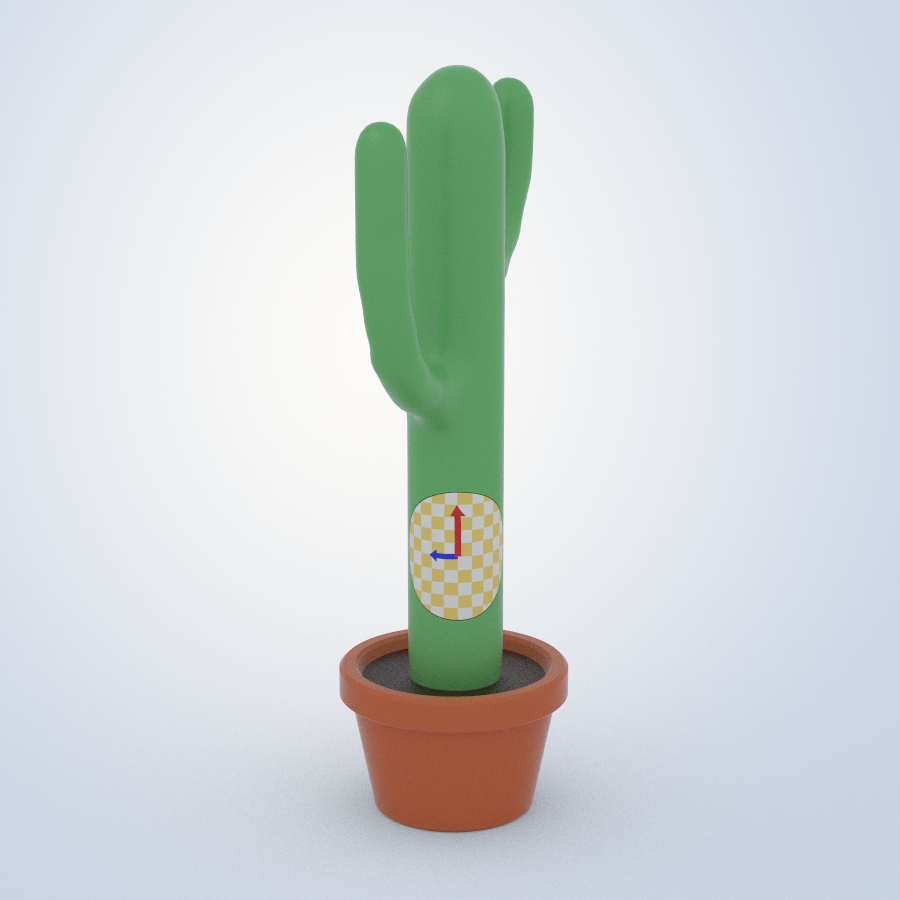
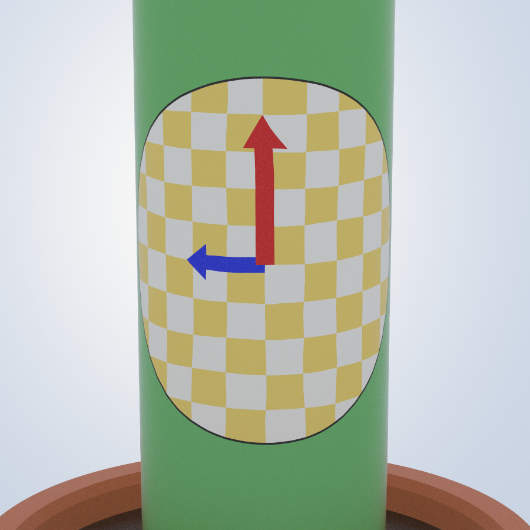
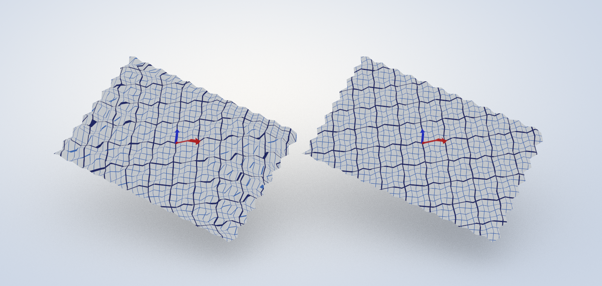

# basic-fem-connection-laplacian-degoes
Basic FEM to compute a vector field through parallel transporting some input vectors using connection laplacian, based off Vector Heat Method

## Showcase: decals and folded paper

`src/showcase.cpp` uses the method for two demonstrations, rendered with a small software rasterizer (no graphics
library).

**A decal on the cactus, pasted with the logarithmic map.** Geodesic polar coordinates around one point: the distance
r comes from the heat method (one scalar heat step, then a Poisson solve), and the angle comes from the vector heat
method with the intrinsic connection of Part III: it is the angle between the direction in which r grows and the
transported source direction. The texture coordinates are r (cos θ, sin θ). The red arrow is the source direction, and
the blue one is a quarter turn to its left. It uses the high-resolution cactus `src/cactus2.obj` (5261 vertices). On
the coarse `cactus1.obj`, a few vertices are sharp cones (angle defects up to 64°), and past a sharp cone the exact
logarithmic map folds over.

<p align="center"> </p>

**A Miura-ori fold, extrinsic (left) and intrinsic (right).** The same logarithmic map of graph paper, computed with the
vertex-normal connection of Part II and with the edge-length connection of Part III. The sheet is intrinsically flat,
so the exact map is the unfolding of the paper; the distances are taken from that unfolding, so the two pictures
differ only in the connection. The intrinsic grid lines run straight across every fold, exactly as if drawn on the flat
paper: the angle error is below 3e-13 degrees. The extrinsic ones break at the folds: the angle error is 2.2 degrees
on average and up to 14.8 degrees.

<p align="center"></p>

```sh
cd src
c++ -std=c++17 -O2 -I/path/to/eigen showcase.cpp HalfEdge/Mesh.cpp -o showcase
./showcase ../showcase            # writes .ppm images; on macOS convert them with: sips -s format png X.ppm --out X.png
./showcase ../showcase 1369 0.17  # optional: source vertex, decal radius, camera elevation and azimuth, trunk height
```

The pictures in `showcase/` and in the notes are path traced from the same data by `src/showcase_render.cpp`
(`src/PathTracer.h`: BVH, area light and sky, glossy coats, shadow-catcher floor, filmic tone curve; no libraries):

```sh
c++ -std=c++17 -O3 -I/path/to/eigen showcase_render.cpp HalfEdge/Mesh.cpp -o showcase_render
./showcase_render ../showcase 256 1    # samples per pixel, resolution scale; about a minute on 10 cores
./showcase_render ../showcase 256 1 atlas   # only one picture: teaser, cactus, miura, whole or atlas
```


## The interactive viewer, extrinsic or intrinsic

`src/FEM.cpp` is the OpenGL viewer of Part I. With `--intrinsic` it assembles the same real 2x2-block system with
the connection of Part III (edge lengths only, `src/IntrinsicConnection.h`), as in Section 34 of the notes; the
result agrees with the complex solver of Part III to 1e-16.

```sh
cd src
c++ -std=c++17 -O2 -I/path/to/eigen FEM.cpp primitivedraw.cpp Laplacian.cpp HalfEdge/*.cpp GA/*.cpp \
    -framework OpenGL -framework GLUT -o fem    # on Linux: -lGL -lglut
./fem               # Part I: vertex normals and rolling
./fem --intrinsic   # Part III: from the edge lengths alone
```

## Geometric algebra version and the notes

`src/GAConnection.h` implements the method in geometric algebra (tangent bivectors, rotors between tangent
planes, the connection as a complex number of the face plane, hat gradients as a reciprocal frame), and
`src/ga_fem.cpp` uses it without graphics: it prints the worked examples of the notes, solves the cactus with the
real 2x2-block system of `FEM.cpp` and with the equivalent complex Hermitian system (they agree to 1e-15), and
validates the result on a sphere against exact parallel transport along great circles.

```sh
cd src
c++ -std=c++17 -O2 -I/path/to/eigen ga_fem.cpp HalfEdge/Mesh.cpp -o ga_fem
./ga_fem ../fem-basic-2d/data                                  # data for the figures
cd ../fem-basic-2d/figures && python3 make_figures.py ../data  # 3D figures as TikZ
```

The notes, `fem-basic-2d/fembasic2d.tex`, derive the method from the PDE to the code (Part I, matrices) and again
in geometric algebra with the intrinsic geometry made explicit (Part II); build them with pdflatex and bibtex from
`fem-basic-2d/` (the code listings are read from `../src`).

Parts III to V build the method from the edge lengths alone (`src/IntrinsicConnection.h`), move the curvature into the
faces with an edge connection and a curved element (`src/EdgeConnection.h`), and derive discrete exterior calculus.
Part VI, "How the Pieces Fit", is a map of all of them: one pipeline, the three choices that distinguish the methods,
where each keeps the curvature, the exact relation between corner and edge transport, the Weitzenboeck identity, a
concept map, a master table and a guide to choosing and extending a method. Its numbers are printed by `ga_fem`
(worked examples 9 and 10, the cactus check, and the rotation field on the sphere, `data/killing_energy.csv`).
